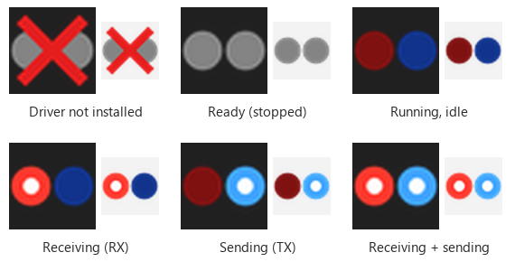
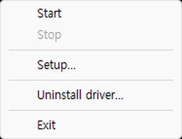
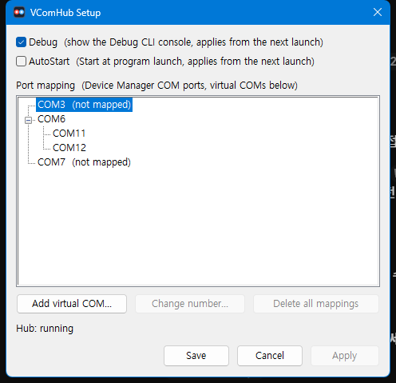
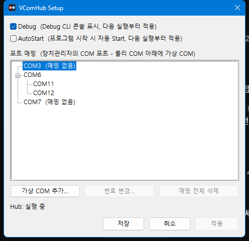

# VComHub

**English** | [한국어](#한국어)

VComHub is a Windows tray application that **shares one physical COM port with several virtual COM ports**. Each serial program opens its own virtual COM port (for example `COM11`, `COM12`), and VComHub relays the data between them and the real device — all programs see what the device sends, and whatever any of them writes goes to the device.

```
              ┌── COM11  ← program A
  COM6 ◄──►  VComHub ─┤
 (device)             └── COM12  ← program B
```

- One executable. No installer: the driver package is embedded in the exe.
- Several physical ports at once (for example `COM6 → COM11, COM12` and `COM7 → COM13`).
- Transparent relay: baud rate, line control, timeouts and modem lines requested by a program on a virtual COM are applied to the physical COM.
- Tray icon that blinks on RX (red) and TX (blue); a small Setup window instead of editing text files.

## Requirements

- Windows 11, 64-bit (x64). Developed and tested on Windows 11 x64; other versions and ARM64 have not been verified.
- Administrator rights (the program asks for them when it starts): creating virtual COM ports and installing the driver need them.
- Nothing else to install: the C++ runtime is linked into the exe, so the Visual C++ Redistributable is **not** needed.

## Quick start

1. Run `vcomhub-<version>.exe` (for example `vcomhub-0.6.7.exe`) and accept the Windows administrator prompt. A tray icon appears (check the hidden-icons arrow `^` of the taskbar if you do not see it).
2. On the **first run** the program creates two files **in the same folder as the exe**: `vcomhub.ini` (settings) and `language.json` (translations). A balloon tells you so. Keep the exe in a folder you can write to.
3. Right-click (or click) the tray icon → **Install driver...** → read the dialog → **Yes**. This is needed once per PC (see [About the driver](#about-the-driver-and-security)).
4. Tray icon → **Setup...** → select your physical COM port (for example `COM6`) → **Add virtual COM...** → type a number (`11` becomes `COM11`) → press Enter. Add as many as you need, then press **Apply**.
5. Tray icon → **Start**. In your serial programs, open the virtual ports (`COM11`, `COM12`) instead of `COM6`.

From now on the program starts relaying by itself whenever it is launched (`AutoStart`). The program does not start with Windows by itself: because it needs administrator rights, a shortcut in the Startup folder does not work. If you want that, create a task in Task Scheduler (trigger "At log on", "Run with highest privileges") that runs the exe.

> Close the programs that use the physical port first: while VComHub is running it owns the physical COM port exclusively.

## Tray icon and menu



*Illustration of the tray icon states (same colors as the program). Hover over the icon to see the version and the number of bytes received (RX, red) and sent (TX, blue).*

| Icon | Meaning |
|---|---|
| Gray circles with a red X | The driver is not installed |
| Gray circles | Ready, not started |
| Dark red / dark blue | Running, no traffic |
| Bright red circle with a white dot | Data is being **received** from the physical COM (RX) |
| Bright blue circle with a white dot | Data is being **sent** to the physical COM (TX) |



| Menu item | What it does |
|---|---|
| **Start** / **Restart** | Reads `vcomhub.ini`, checks it, creates the virtual COM ports and starts relaying. While running it becomes **Restart** (it re-reads the ini); it reads **Restart (settings changed)** when the saved mappings differ from what is running. |
| **Stop** | Stops relaying and deletes the virtual COM ports. If a program still has a virtual COM open, the program waits up to `StopTimeoutMs` and then tells you which ports are in use — close them and Stop again. |
| **Setup...** | Opens the settings window (below). |
| **Install driver...** / **Uninstall driver...** | Only shown when relevant. Uninstall is available while stopped. |
| **Exit** | Stops relaying, then quits. |

## Setup window



Open it from the tray menu (**Setup...**). It reads `vcomhub.ini` **when it opens** — changes made to the ini file while the window is open are ignored, so do not edit both at the same time.

- **Debug** – show the Debug CLI console at the next launch.
- **AutoStart** – start relaying automatically when the program starts (applies from the next launch).
- **Port mapping** – the COM ports of Device Manager (VComHub's own virtual ports are not listed as physical ports). A physical COM with virtual COMs under it is a mapping.
  - Select a physical COM → **Add virtual COM...** or double-click it, then type the number.
  - Select a virtual COM → **Change number...** or double-click it; **Delete** removes it. **Delete all mappings** removes every virtual COM of a physical COM.
  - Keyboard: `Insert` add, `F2` change, `Delete` delete.
  - `(not mapped)` = no virtual COM yet. `(not in the system)` = the ini lists a port that is not currently present (device unplugged).
- Buttons
  - **Apply** – saves to `vcomhub.ini` **and applies it to the running program** (it restarts the relay if the mappings changed). No question is asked.
  - **Save** – saves to the ini and closes. If you saved changes while running, a balloon reminds you to use **Restart** from the tray menu. If there are no changes but a restart is pending, it asks whether to apply now.
  - **Cancel** – closes without saving (asks first if there are unapplied changes).
- The status text under the buttons says whether a **Restart is needed** (the saved mappings differ from the running ones).

## `vcomhub.ini` reference

The file is next to the exe. You can edit it with Setup or by hand (Notepad). Lines starting with `;` are comments.

```ini
[Hub]
Debug=false
AutoStart=true
TrayBlink=true
StopTimeoutMs=3000
Language=en

[Mappings]
PhysicalPorts=COM6,COM7

[Physical.COM6]
VirtualPorts=COM11,COM12

[Physical.COM7]
VirtualPorts=COM13
```

| Key | Default | Meaning |
|---|---|---|
| `[Hub] Debug` | `false` | `true` opens a console with the [Debug CLI](#debug-cli) at the next launch. |
| `[Hub] AutoStart` | `true` | Start relaying when the program launches. If it fails (for example the device is not ready yet) it does **not** retry — use **Start**. |
| `[Hub] TrayBlink` | `true` | Blink the tray icon on RX/TX. |
| `[Hub] StopTimeoutMs` | `3000` | How long Stop waits for programs to close a virtual COM (0–60000 ms). |
| `[Hub] Language` | `en` | `en` or `kr` (see [Language](#language)). Anything else means `en`. |
| `[Mappings] PhysicalPorts` | – | Comma-separated physical COM ports to relay. Empty means nothing to relay. |
| `[Physical.<COM>] VirtualPorts` | – | Comma-separated virtual COM ports for that physical COM. One section per entry of `PhysicalPorts`. |

Rules (Start refuses to run and tells you what is wrong otherwise):

- Every physical COM in `PhysicalPorts` must exist in Device Manager when you Start.
- Virtual COM names must be **`COM<number>`** (for example `COM11`). Windows may rename other names, so they are rejected.
- A virtual COM name may be used only once, must not be the name of a physical COM, and must not be a COM port that already exists on the PC (another device, another program's virtual port). VComHub never renames to avoid a clash — choose a free number.
- A virtual COM belongs to exactly one physical COM.
- Serial settings (baud rate, parity ...) are **not** in the ini: the program that opens a virtual COM sets them, and they are forwarded to the physical COM (identical requests are skipped; the last request wins).

To apply a manual edit: **Restart** from the tray menu while running, or **Start** when stopped.

## How the relay behaves

- Data received from the physical COM is copied to **every open** virtual COM of that group. Data written to any virtual COM goes to the physical COM in arrival order. Other groups are never affected.
- A virtual COM can be opened by **one program at a time**. A program that does not read its virtual COM has a 64 KiB receive queue; when it overflows that program gets an overrun error and nothing else is affected.
- If the physical COM fails or is unplugged, requests of that group finish with an error and the other groups keep working. After reconnecting the device, use **Restart**.
- Starting a second copy of the program does nothing (only one instance runs).

## Language

The program speaks **English** by default. Set `Language=kr` in `vcomhub.ini` for Korean. The texts live in `language.json` (next to the exe, recreated on first run if missing):

```json
{ "en": { "Already stopped.": "Already stopped." },
  "kr": { "Already stopped.": "이미 중지 상태입니다." } }
```

To add a language, copy the `kr` section under a new name (for example `"ja"`), translate the **values** (keep the keys and the `{0}`, `{1}` placeholders), and set `Language=ja`. Missing texts fall back to English; a missing or broken `language.json` means English. Command names of the Debug CLI always stay English.

## Debug CLI

Set `Debug=true` (or start the exe with `--debug`) to get a console where you can type commands. Responses follow the selected language; command names are always English. Type `help` for the full list.

| Command | Meaning |
|---|---|
| `status` | Running state, traffic, mappings |
| `start`, `stop`, `exit` | Same as the tray menu |
| `mapping show` | Mappings in the ini (and whether a Restart is needed) |
| `mapping add <physical> <virtual\|number>` | Add a virtual COM, saved to the ini immediately |
| `mapping rename <virtual> <new\|number>` | Change a virtual COM name |
| `mapping remove <virtual\|physical>` | Remove a virtual COM, or all mappings of a physical COM |
| `mapping option debug\|autostart on\|off` | Change `Debug` / `AutoStart` |
| `config validate` | Check the ini and the system without starting |
| `devices list` | COM ports of the PC |
| `driver status`, `driver install`, `driver uninstall [purge]` | Driver package (no confirmation asked here; `purge` also deletes the ini) |
| `selftest [echo]` | Self check of the relay (`echo` needs a device that answers on the physical COM) |
| `setup` | Open the Setup window |
| `version` | Version |

Command line options: `--ini <path>` use another ini (nothing is created automatically for an explicit path), `--debug` force the console, `--language-file <path>` use another `language.json`. `--sim` / `--sim-driver` run without real hardware / driver (for testing).

## About the driver and security

VComHub needs a small Windows driver to create the virtual COM ports. The driver is **signed with a self-signed certificate** (`CN=VComHub Driver Signing, O=c0z0c`), not with a commercial code-signing certificate. To let Windows load it, **Install driver...** registers that certificate in this PC's **Trusted Root Certification Authorities** and **Trusted Publishers** stores and adds the driver package to the Windows driver store. The dialog shows the certificate name and fingerprint and asks for confirmation; nothing is changed if you answer No.

- Trusting a certificate is a security decision. Install it only if you trust where you got the exe, and compare the SHA256 in `VERSION.txt` with the file.
- **Uninstall driver...** (tray menu, while stopped) removes the virtual COM ports, the driver package and the certificate. Tick *Also delete the configuration file* to remove `vcomhub.ini` too. The exe itself is not deleted — delete it by hand.
- Verified on a Windows 11 x64 PC. Installation on other PCs, with Secure Boot / stricter driver policies, and on ARM64 has **not** been verified.

## Troubleshooting

| Symptom | What to do |
|---|---|
| Start fails with "driver is not registered" | Install the driver (tray menu → Install driver...). |
| Start fails with configuration errors | The message lists each problem (missing physical COM, name clash, name not `COM<number>`). Fix it in Setup and Start again. Try `config validate` in the Debug CLI. |
| "Physical COM not found" after a reboot | USB serial adapters can appear after VComHub starts. AutoStart does not retry: plug the adapter in and use **Start**. |
| Stop reports virtual COM ports in use | Close the serial programs that opened `COM11`, `COM12` ..., then Stop again. |
| A serial program cannot open the physical COM | VComHub owns it while running. Open a virtual COM instead, or Stop. |
| No tray icon | Look in the hidden icons (`^`). Only one instance runs; a second start does nothing. |
| The settings window or messages are in the wrong language | Set `Language=` in `vcomhub.ini` (`en` or `kr`) and restart the program. |

## Files

| File | Purpose |
|---|---|
| `vcomhub-<version>.exe` | The program (driver package embedded). The file name does not matter to the program. |
| `vcomhub.ini` | Settings (created next to the exe on first run) |
| `language.json` | Translations (created next to the exe on first run) |
| `vcomhub-<version>.sbom.json` | Software Bill of Materials (CycloneDX 1.5) of that exe: embedded driver package and certificate with hashes, imported Windows DLLs, the statically linked Microsoft C/C++ runtime, build information. VComHub uses no third-party libraries. |
| `VERSION.txt` | Version, source commit, build time and SHA256 of the exe |

Release builds put `vcomhub-<version>.exe` and its `.sbom.json` in the `release` folder of the release repository.

## Version history

The version is `<major>.<minor>.<number of commits>`, so the last number grows with every change in the source repository. Newest first. Versions that were not published (0.6.12 – 0.6.17) are included in the next published one.

### 0.6.18 (2026-10-15)

- **Hang prevention**: Stop and Exit always finish. Exit escalates in three steps (normal stop → force-delete virtual COM that is still in use → forced close). If it had to be forced, the next launch shows a notice and a `.exit.log` file next to the ini says what to check. New `[Hub] ExitTimeoutMs` (3000–120000). A physical COM that does not respond is abandoned instead of blocking the others.
- **Device loss and reconnect**: when a physical COM is unplugged (including USB drivers that keep returning success, such as Prolific), the tray tells you; the group reconnects automatically when the device comes back. Other groups keep working.
- **Missing physical COM at Start**: that mapping is skipped (its virtual COM is not created) and the others start; it is connected automatically when the device appears.
- Operations that overlap (for example Start while Stopping) answer "Busy" instead of waiting; the status text shows *Stopping*.
- First run with an empty mapping no longer tries to AutoStart and shows a clear message instead.
- Debug mode writes `vcomhub.debug.log` next to the exe (open/close/error/reconnect events and device-change notifications, no data bytes).
- Debug CLI: `sim hang <COM> ctl|write|close on|off` for testing hang handling (with `--sim`).

### 0.6.11 (2026-10-08)

- Tray menu **About...**: version, build time, developer, homepage.
- Version is now generated from the commit count; Debug builds show a trailing `d`.

### 0.6.10 (2026-10-08)

- Setup window layout fix: the buttons are no longer overlapped by the port list (taller window, clipped child controls).
- Single executable with the driver package embedded; automatic elevation to administrator.
- Several physical COM ports at once, each with several virtual COM ports; transparent relay of baud rate, line control, timeouts and modem lines.
- Tray icon with RX (red) / TX (blue) blinking and a tooltip with byte counts.
- Setup window, `AutoStart`, English / Korean UI (`language.json`), Debug CLI.
- Software Bill of Materials (`.sbom.json`) for each exe.

## Contact

c0z0c@hotmail.com

---

<a id="한국어"></a>

# VComHub (한국어)

[English](#vcomhub) | **한국어**

VComHub 는 **하나의 실제 COM 포트를 여러 가상 COM 포트로 나눠 쓰게 해 주는** Windows 트레이 프로그램입니다. 시리얼 프로그램마다 각자의 가상 COM(예: `COM11`, `COM12`)을 열면, VComHub 가 실제 장치와 데이터를 중계합니다. 모든 프로그램이 장치가 보낸 데이터를 받고, 어느 프로그램이 쓰든 장치로 전달됩니다.

- exe 하나로 동작합니다. 설치 프로그램이 없고 드라이버 패키지는 exe 안에 들어 있습니다.
- 여러 실제 포트를 동시에 처리합니다 (예: `COM6 → COM11, COM12`, `COM7 → COM13`).
- 투명 중계: 가상 COM 에서 프로그램이 요청한 보드레이트, 라인 제어, 타임아웃, 모뎀 신호가 실제 COM 에 적용됩니다.
- RX(빨강)/TX(파랑)로 깜빡이는 트레이 아이콘, 텍스트 파일 대신 쓰는 작은 설정(Setup) 창.

## 요구 사항

- Windows 11 64비트(x64). Windows 11 x64 에서 개발하고 확인했습니다. 다른 버전과 ARM64 는 확인하지 못했습니다.
- 관리자 권한(실행할 때 Windows 가 물어봅니다): 가상 COM 생성과 드라이버 설치에 필요합니다.
- 따로 설치할 것은 없습니다. C++ 런타임이 exe 안에 들어 있어(정적 링크) Visual C++ 재배포 가능 패키지가 **필요 없습니다**.

## 빠른 시작

1. `vcomhub-<버전>.exe`(예: `vcomhub-0.6.7.exe`)를 실행하고 관리자 확인 창을 승인합니다. 트레이 아이콘이 생깁니다(안 보이면 작업 표시줄의 숨겨진 아이콘 `^` 를 확인하세요).
2. **처음 실행**하면 exe 와 **같은 폴더**에 `vcomhub.ini`(설정)와 `language.json`(번역)을 만들고 풍선으로 알려 줍니다. 쓸 수 있는 폴더에 두세요.
3. 트레이 아이콘 → **드라이버 설치...**(영어 모드는 *Install driver...*) → 내용을 읽고 **예**. PC 당 한 번만 하면 됩니다([드라이버와 보안](#드라이버와-보안) 참고).
4. 트레이 아이콘 → **설정...** → 실제 COM(예: `COM6`) 선택 → **가상 COM 추가...** → 번호 입력(`11` 은 `COM11`) → Enter. 필요한 만큼 추가하고 **적용**을 누릅니다.
5. 트레이 아이콘 → **시작**. 시리얼 프로그램에서는 `COM6` 대신 가상 포트(`COM11`, `COM12`)를 엽니다.

이후에는 프로그램을 실행하면 자동으로 중계를 시작합니다(`AutoStart`). Windows 로그인 때 자동으로 실행하려면 관리자 권한 때문에 시작 프로그램 폴더 바로가기로는 안 되고, "가장 높은 권한으로 실행"을 켠 작업 스케줄러가 필요합니다.

> 실제 포트를 쓰던 프로그램은 먼저 닫으세요. VComHub 가 실행 중이면 실제 COM 을 단독으로 엽니다.

## 트레이 아이콘과 메뉴


*트레이 아이콘 상태 그림(프로그램과 같은 색으로 그린 예시). 아이콘에 마우스를 올리면 버전과 받은(RX, 빨강)/보낸(TX, 파랑) 누적 바이트가 보입니다.*

| 아이콘 | 의미 |
|---|---|
| 회색 원 + 빨간 X | 드라이버가 설치되지 않음 |
| 회색 원 | 준비됨, 시작 전 |
| 어두운 빨강/파랑 | 실행 중, 통신 없음 |
| 흰 점이 있는 밝은 빨강 | 실제 COM 에서 데이터 **수신(RX)** 중 |
| 흰 점이 있는 밝은 파랑 | 실제 COM 으로 데이터 **송신(TX)** 중 |


| 메뉴 | 동작 |
|---|---|
| **시작** / **다시 시작** | `vcomhub.ini` 를 읽고 검사한 뒤 가상 COM 을 만들고 중계를 시작합니다. 실행 중에는 **다시 시작**(ini 를 다시 읽음)이 되고, 저장된 매핑이 실행 중인 것과 다르면 **다시 시작 (설정 변경됨)** 으로 표시됩니다. |
| **중지** | 중계를 멈추고 가상 COM 을 지웁니다. 프로그램이 가상 COM 을 열고 있으면 `StopTimeoutMs` 까지 기다린 뒤 사용 중인 포트를 알려 줍니다. 그 프로그램을 닫고 다시 중지하세요. |
| **설정...** | 설정 창을 엽니다(아래). |
| **드라이버 설치...** / **드라이버 제거...** | 상황에 맞는 것만 보입니다. 제거는 중지 상태에서만 가능합니다. |
| **종료** | 중계를 멈춘 뒤 종료합니다. |

## 설정(Setup) 창



트레이 메뉴의 **설정...** 으로 엽니다. `vcomhub.ini` 는 **창을 열 때 한 번만** 읽습니다. 창이 열려 있는 동안 ini 파일을 직접 고친 것은 무시되니, 둘을 동시에 고치지 마세요.

- **Debug** – 다음 실행부터 Debug CLI 콘솔을 보입니다.
- **AutoStart** – 프로그램을 시작할 때 자동으로 중계를 시작합니다(다음 실행부터 적용).
- **포트 매핑** – 장치관리자의 COM 포트 목록입니다(VComHub 가 만든 가상 COM 은 실제 포트로 나오지 않습니다). 실제 COM 아래에 가상 COM 이 있는 것이 매핑입니다.
  - 실제 COM 선택 → **가상 COM 추가...** 또는 더블클릭 → 번호 입력.
  - 가상 COM 선택 → **번호 변경...** 또는 더블클릭, **삭제**. **매핑 전체 삭제**는 그 실제 COM 의 가상 COM 을 모두 지웁니다.
  - 키보드: `Insert` 추가, `F2` 변경, `Delete` 삭제.
  - `(매핑 없음)` = 아직 가상 COM 이 없음. `(시스템에 없음)` = ini 에는 있지만 지금 PC 에 없는 포트(장치를 뽑은 경우).
- 버튼
  - **적용** – `vcomhub.ini` 에 저장하고 **실행 중인 프로그램에도 반영**합니다(매핑이 바뀌었으면 중계를 다시 시작). 묻지 않습니다.
  - **저장** – ini 에만 저장하고 닫습니다. 실행 중에 변경을 저장하면 트레이 풍선으로 **다시 시작**이 필요하다고 알려 줍니다. 변경이 없는데 다시 시작이 필요한 상태면 지금 적용할지 묻습니다.
  - **취소** – 저장하지 않고 닫습니다(적용하지 않은 변경이 있으면 먼저 묻습니다).
- 버튼 아래 상태 문구에 **다시 시작이 필요한지**(저장된 매핑이 실행 중인 것과 다른지) 나옵니다.

## `vcomhub.ini` 설명

exe 옆에 있습니다. 설정 창이나 메모장으로 고칠 수 있습니다. `;` 로 시작하는 줄은 주석입니다.

```ini
[Hub]
Debug=false
AutoStart=true
TrayBlink=true
StopTimeoutMs=3000
Language=kr

[Mappings]
PhysicalPorts=COM6,COM7

[Physical.COM6]
VirtualPorts=COM11,COM12

[Physical.COM7]
VirtualPorts=COM13
```

| 키 | 기본값 | 의미 |
|---|---|---|
| `[Hub] Debug` | `false` | `true` 이면 다음 실행부터 [Debug CLI](#debug-cli-1) 콘솔이 열립니다. |
| `[Hub] AutoStart` | `true` | 프로그램 시작 시 자동으로 중계를 시작합니다. 실패하면(예: 장치가 아직 준비되지 않음) **재시도하지 않으니** **시작**을 누르세요. |
| `[Hub] TrayBlink` | `true` | RX/TX 로 트레이 아이콘을 깜빡입니다. |
| `[Hub] StopTimeoutMs` | `3000` | 중지할 때 프로그램이 가상 COM 을 닫을 때까지 기다리는 시간(0~60000 ms). |
| `[Hub] Language` | `en` | `en` 또는 `kr`([언어](#언어) 참고). 다른 값은 `en` 으로 봅니다. |
| `[Mappings] PhysicalPorts` | – | 중계할 실제 COM 을 쉼표로 나열합니다. 비어 있으면 중계할 것이 없습니다. |
| `[Physical.<COM>] VirtualPorts` | – | 그 실제 COM 의 가상 COM 을 쉼표로 나열합니다. `PhysicalPorts` 의 항목마다 섹션이 하나씩 필요합니다. |

규칙(어기면 시작하지 않고 무엇이 문제인지 알려 줍니다):

- `PhysicalPorts` 의 실제 COM 은 시작할 때 장치관리자에 있어야 합니다.
- 가상 COM 이름은 **`COM<번호>`**(예: `COM11`) 형식이어야 합니다. 다른 이름은 Windows 가 바꿀 수 있어 거부합니다.
- 가상 COM 이름은 한 번만 쓸 수 있고, 실제 COM 이름과 같으면 안 되며, 이미 PC 에 있는 COM 포트(다른 장치, 다른 프로그램의 가상 포트)와 겹치면 안 됩니다. 충돌을 피해 자동으로 이름을 바꾸지 않으니 비어 있는 번호를 고르세요.
- 가상 COM 하나는 실제 COM 하나에만 속합니다.
- 시리얼 설정(보드레이트, 패리티 등)은 ini 에 없습니다. 가상 COM 을 여는 프로그램이 정하고, 그 요청이 실제 COM 에 전달됩니다(같은 요청은 건너뛰고, 마지막 요청이 적용됩니다).

직접 고친 내용을 적용하려면 실행 중에는 트레이 메뉴 **다시 시작**, 중지 상태에서는 **시작**을 누르세요.

## 중계 동작

- 실제 COM 에서 받은 데이터는 그 그룹의 **열려 있는 모든** 가상 COM 에 복사됩니다. 어느 가상 COM 에서 쓴 데이터든 도착한 순서대로 실제 COM 으로 나갑니다. 다른 그룹에는 영향이 없습니다.
- 가상 COM 은 **한 번에 한 프로그램**만 열 수 있습니다. 가상 COM 을 읽지 않는 프로그램은 64 KiB 수신 큐가 넘치면 그 프로그램만 오버런 오류를 받고 다른 곳에는 영향이 없습니다.
- 실제 COM 이 오류가 나거나 뽑히면 그 그룹의 요청이 오류로 끝나고 다른 그룹은 계속 동작합니다. 장치를 다시 연결한 뒤 **다시 시작**하세요.
- 프로그램을 두 번 실행해도 아무 일도 일어나지 않습니다(하나만 실행됩니다).

## 언어

기본은 **영어**입니다. 한국어로 쓰려면 `vcomhub.ini` 에 `Language=kr` 을 적습니다. 문구는 exe 옆의 `language.json` 에 있고, 없으면 첫 실행에 다시 만듭니다.

새 언어를 추가하려면 `kr` 섹션을 새 이름(예: `"ja"`)으로 복사해 **값**을 번역하고(키와 `{0}`, `{1}` 자리표시자는 그대로 둠) `Language=ja` 로 지정합니다. 번역이 없는 문구는 영어로 나오고, `language.json` 이 없거나 깨졌으면 영어로 동작합니다. Debug CLI 의 명령 이름은 항상 영어입니다.

## Debug CLI

<a id="debug-cli-1"></a>

`Debug=true`(또는 exe 를 `--debug` 로 실행)이면 명령을 입력할 수 있는 콘솔이 열립니다. 응답은 선택한 언어로 나오고 명령 이름은 항상 영어입니다. 전체 목록은 `help` 로 봅니다.

| 명령 | 의미 |
|---|---|
| `status` | 실행 상태, 트래픽, 매핑 |
| `start`, `stop`, `exit` | 트레이 메뉴와 같음 |
| `mapping show` | ini 의 매핑(다시 시작이 필요한지 포함) |
| `mapping add <물리> <가상\|번호>` | 가상 COM 추가, 즉시 ini 에 저장 |
| `mapping rename <가상> <새이름\|번호>` | 가상 COM 이름 변경 |
| `mapping remove <가상\|물리>` | 가상 COM 삭제, 또는 실제 COM 의 매핑 전체 삭제 |
| `mapping option debug\|autostart on\|off` | `Debug` / `AutoStart` 변경 |
| `config validate` | 시작하지 않고 ini 와 시스템을 검사 |
| `devices list` | PC 의 COM 포트 |
| `driver status`, `driver install`, `driver uninstall [purge]` | 드라이버 패키지(여기서는 확인을 묻지 않음, `purge` 는 ini 도 삭제) |
| `selftest [echo]` | 중계 자가 점검(`echo` 는 실제 COM 에 응답하는 장치 필요) |
| `setup` | 설정 창 열기 |
| `version` | 버전 |

명령줄 옵션: `--ini <경로>` 다른 ini 사용(직접 지정한 경로는 자동으로 만들지 않음), `--debug` 콘솔 강제, `--language-file <경로>` 다른 `language.json` 사용. `--sim` / `--sim-driver` 는 실제 장치/드라이버 없이 실행(테스트용).

## 드라이버와 보안

가상 COM 을 만들려면 작은 Windows 드라이버가 필요합니다. 이 드라이버는 상용 코드 서명 인증서가 아니라 **자체 서명 인증서**(`CN=VComHub Driver Signing, O=c0z0c`)로 서명되어 있습니다. Windows 가 드라이버를 로드하도록 **드라이버 설치...** 는 이 인증서를 PC 의 **신뢰할 수 있는 루트 인증 기관**과 **신뢰할 수 있는 게시자** 저장소에 등록하고 드라이버 패키지를 Windows 드라이버 저장소에 추가합니다. 확인 창에 인증서 이름과 지문이 나오고, **아니요**를 누르면 아무것도 바꾸지 않습니다.

- 인증서를 신뢰하는 것은 보안 결정입니다. exe 를 받은 곳을 신뢰할 때만 설치하고, `VERSION.txt` 의 SHA256 과 파일을 비교하세요.
- **드라이버 제거...**(트레이 메뉴, 중지 상태에서) 는 가상 COM, 드라이버 패키지, 인증서를 모두 제거합니다. *설정 파일도 삭제*를 체크하면 `vcomhub.ini` 도 지웁니다. exe 자체는 지우지 않으니 직접 삭제하세요.
- Windows 11 x64 PC 에서 확인했습니다. 다른 PC, Secure Boot 등 더 엄격한 드라이버 정책 환경, ARM64 에서의 설치는 **확인하지 못했습니다**.

## 문제 해결

| 증상 | 해결 |
|---|---|
| 시작할 때 "드라이버가 등록되어 있지 않습니다" | 드라이버를 설치하세요(트레이 메뉴 → 드라이버 설치...). |
| 설정 오류로 시작하지 못함 | 메시지에 문제가 하나씩 나옵니다(없는 실제 COM, 이름 충돌, `COM<번호>` 아님). 설정 창에서 고치고 다시 시작하세요. Debug CLI 의 `config validate` 도 써 보세요. |
| 재부팅 후 "물리 COM 이 시스템에 없습니다" | USB 시리얼 어댑터가 VComHub 보다 늦게 나타날 수 있습니다. AutoStart 는 재시도하지 않으니 어댑터가 잡힌 뒤 **시작**을 누르세요. |
| 중지할 때 가상 COM 이 사용 중이라고 나옴 | `COM11`, `COM12` ... 를 연 시리얼 프로그램을 닫고 다시 중지하세요. |
| 시리얼 프로그램이 실제 COM 을 열지 못함 | 실행 중에는 VComHub 가 단독으로 엽니다. 가상 COM 을 열거나 중지하세요. |
| 트레이 아이콘이 안 보임 | 숨겨진 아이콘(`^`)을 확인하세요. 프로그램은 하나만 실행되며 두 번째 실행은 아무 일도 하지 않습니다. |
| 화면이나 메시지 언어가 다름 | `vcomhub.ini` 의 `Language=`(`en` 또는 `kr`)를 고치고 프로그램을 다시 시작하세요. |

## 파일

| 파일 | 용도 |
|---|---|
| `vcomhub-<버전>.exe` | 프로그램(드라이버 패키지 내장). 파일 이름은 프로그램 동작과 무관합니다. |
| `vcomhub.ini` | 설정(처음 실행할 때 exe 옆에 생성) |
| `language.json` | 번역(처음 실행할 때 exe 옆에 생성) |
| `vcomhub-<버전>.sbom.json` | 그 exe 의 소프트웨어 자재 명세서(SBOM, CycloneDX 1.5): 내장 드라이버 패키지와 인증서(해시 포함), 가져오는 Windows DLL, 정적으로 링크된 Microsoft C/C++ 런타임, 빌드 정보. VComHub 는 서드파티 라이브러리를 쓰지 않습니다. |
| `VERSION.txt` | 버전, 소스 커밋, 빌드 시각, exe 의 SHA256 |

Release 빌드는 `vcomhub-<버전>.exe` 와 `.sbom.json` 을 배포 저장소의 `release` 폴더에 넣습니다.

## 버전 기록

버전은 `<major>.<minor>.<커밋 수>` 이므로 소스 저장소에서 변경이 생길 때마다 마지막 숫자가 늘어납니다. 최신 버전이 위에 있습니다. 배포하지 않은 버전(0.6.12 ~ 0.6.17)의 변경은 다음 배포 버전에 포함되어 있습니다.

### 0.6.18 (2026-10-15)

- **행(hang) 방지**: 중지와 종료는 항상 끝납니다. 종료는 3단계로 단계적으로 강해집니다(정상 중지 → 사용 중인 가상 COM 강제 삭제 → 강제 닫기). 강제로 닫았다면 다음 실행 때 알려 주고, ini 옆의 `.exit.log` 파일에 확인할 내용이 남습니다. `[Hub] ExitTimeoutMs`(3000~120000) 추가. 응답이 없는 실제 COM 은 다른 그룹을 막지 않고 포기합니다.
- **장치 분리와 재연결**: 실제 COM 이 뽑히면(분리돼도 성공을 계속 돌려주는 Prolific 같은 USB 드라이버 포함) 트레이로 알려 주고, 장치가 돌아오면 그 그룹을 자동으로 다시 연결합니다. 다른 그룹은 계속 동작합니다.
- **시작할 때 실제 COM 이 없는 경우**: 그 매핑만 건너뛰고(가상 COM 은 만들지 않음) 나머지는 시작하며, 장치가 나타나면 자동으로 연결합니다.
- 겹치는 작업(예: 중지 중에 시작)은 기다리지 않고 "작업 중" 안내를 하며, 상태 문구에 *Stopping* 이 표시됩니다.
- 매핑이 비어 있는 첫 실행에서는 AutoStart 를 시도하지 않고 분명한 메시지를 보여 줍니다.
- Debug 모드에서 exe 옆에 `vcomhub.debug.log` 를 기록합니다(열기/닫기/오류/재연결 이벤트와 장치 변경 알림, 데이터 바이트는 기록하지 않음).
- Debug CLI: 행 처리 테스트용 `sim hang <COM> ctl|write|close on|off` (`--sim` 에서).

### 0.6.11 (2026-10-08)

- 트레이 메뉴 **정보...**(About): 버전, 빌드 시각, 개발자, 홈페이지.
- 버전을 커밋 수로 자동 생성합니다. Debug 빌드는 끝에 `d` 가 붙습니다.

### 0.6.10 (2026-10-08)

- 설정 창 배치 수정: 버튼이 포트 목록에 가려지지 않습니다(창 높이 확대, 자식 컨트롤 클리핑).
- 드라이버 패키지를 내장한 단일 exe, 관리자 권한 자동 요청.
- 여러 실제 COM 을 동시에 처리하고 각각에 여러 가상 COM 을 연결. 보드레이트, 라인 제어, 타임아웃, 모뎀 신호를 투명하게 중계.
- RX(빨강)/TX(파랑)로 깜빡이는 트레이 아이콘과 누적 바이트 툴팁.
- 설정 창, `AutoStart`, 영어/한국어 UI(`language.json`), Debug CLI.
- exe 마다 소프트웨어 자재 명세서(`.sbom.json`).
